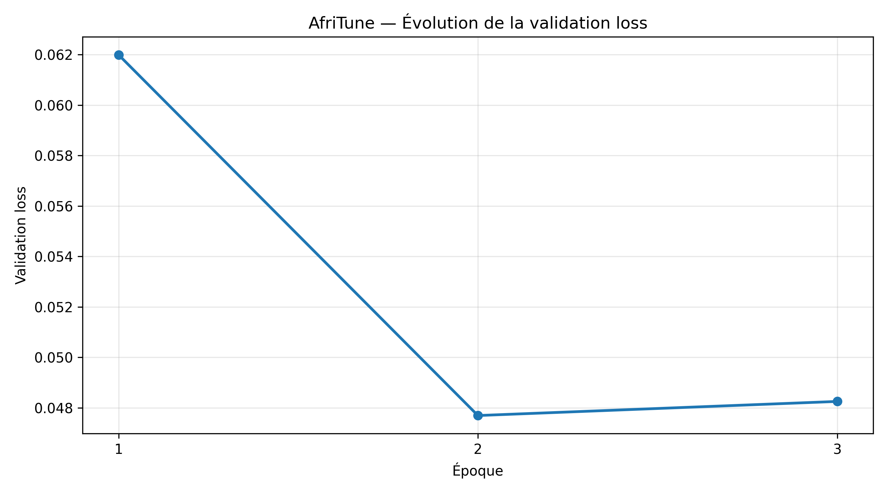
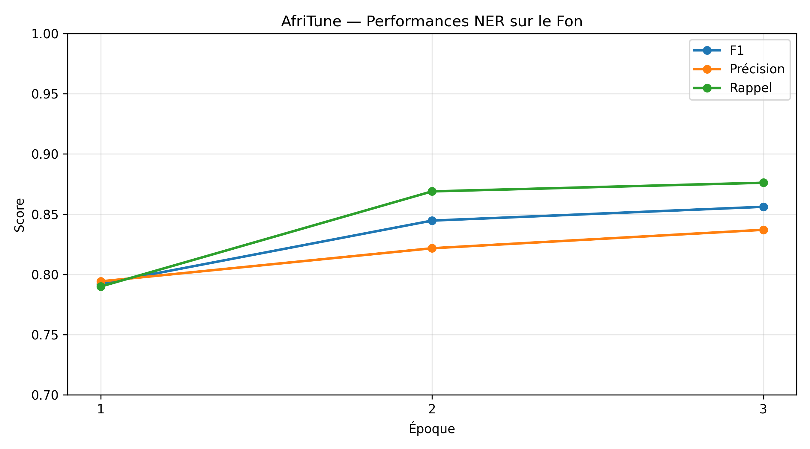
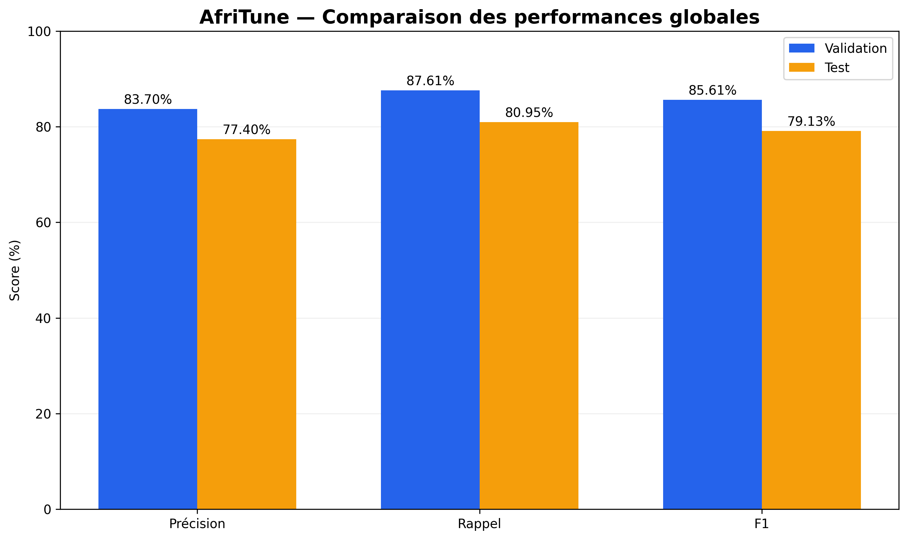
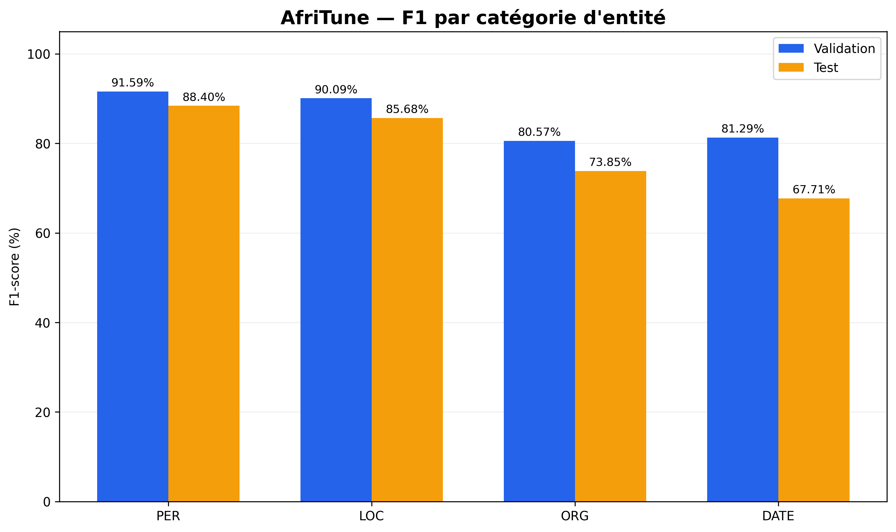
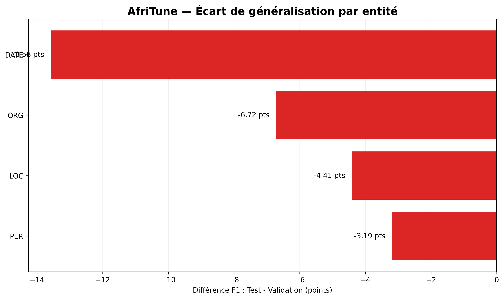

# AfriTune 🌍

**Reproducibility-focused NLP research for African languages.**

AfriTune's first experiment fine-tunes **XLM-RoBERTa Base** for **Fon Named Entity Recognition** using the Fon portion of **MasakhaNER 2.0**.

## Experimental results

| Model | Validation entity-level F1 | Held-out test entity-level F1 |
|---|---:|---:|
| XLM-RoBERTa Base | 85.61% | **79.13%** |

Test entity-level micro-precision: **77.40%**; micro-recall: **80.95%**. The results come from **one training run** (seed 42), not a state-of-the-art comparison.

| Entity type | Test F1 |
|---|---:|
| DATE | 67.71% |
| LOC | 85.68% |
| ORG | 73.85% |
| PER | 88.40% |

## Experimental visualizations

The following figures were exported from the original Fon NER experiment. They illustrate training behavior and the difference between validation and held-out test performance.

### Validation loss



### NER evaluation metrics



### Validation versus test performance



### Entity-level F1 comparison



### Generalization gap



The visualizations describe **one run**. They do not quantify variability across seeds or establish a causal explanation for differences between validation and test results. The original numerical reports are available in [`results/ner_validation_report.csv`](results/ner_validation_report.csv) and [`results/ner_test_report.csv`](results/ner_test_report.csv).

## Method

- **Data:** 4,343 train / 623 validation / 1,228 test sentences.
- **Labels:** BIO tagging for DATE, LOC, ORG, and PER (nine tags including O).
- **Backbone:** `FacebookAI/xlm-roberta-base`.
- **Tokenization:** first-subtoken labeling; other subtokens and special tokens ignored (`-100`).
- **Maximum length:** 256 subtokens.
- **Training:** 3 epochs, learning rate 2e-5, batch size 4, gradient accumulation 4, weight decay 0.01, FP16 on Tesla T4.
- **Checkpoint selection:** highest validation entity-level F1; test evaluated separately.

## Get started

Open [the public Fon NER notebook](AfriTune_Fon_NER_Public_English.ipynb) to inspect the full workflow. The notebook downloads a **pinned reference snapshot** of the Fon dataset and verifies upstream Git blob hashes. This pinned snapshot has not been established as the exact revision used in the original run.

For a local copy of the reference dataset, the repository includes an optional downloader:

```bash
python scripts/download_fon.py --output-dir data/fon
```

The notebook currently uses its own verified network download and does not automatically load files downloaded by the standalone script. **No fresh GPU rerun has been performed as part of this documentation release.**

## Repository guide

| Resource | Description |
|---|---|
| [Public notebook](AfriTune_Fon_NER_Public_English.ipynb) | Fon NER preprocessing, fine-tuning, evaluation, and visualization workflow |
| [Scientific report](docs/scientific_report.md) | Research methodology, results, and limitations |
| [Reproducibility guide](docs/reproducibility.md) | Setup instructions and verification checklist |
| [Notebook audit](docs/notebook_audit.md) | Static review of methodological and portability risks |
| [Requirements](requirements.txt) | Provisional notebook installation constraints; **not** an exact environment lockfile |
| [Dataset downloader](scripts/download_fon.py) | Fixed-reference Fon data download with integrity verification |
| [Evaluation results](results/README.md) | Validation and test metrics and original figures |

## Community and project governance

- [Contributing guide](CONTRIBUTING.md) — how to propose and review changes.
- [Code of conduct](CODE_OF_CONDUCT.md) — expectations for respectful collaboration.
- [Security policy](SECURITY.md) — how to report sensitive issues privately.
- [Roadmap](docs/roadmap.md) — completed work and future research milestones.
- [Changelog](CHANGELOG.md) — documentation milestones.
- [Citation guidance](CITATION.md) — provisional repository citation (no DOI yet).
- [Licensing status](docs/licensing.md) — **no repository license selected yet**; third-party rights require review.

GitHub issue and pull-request templates are available for contributors.

## Research limitations

- Results are from **one training run**, without multi-seed uncertainty estimates.
- The historical dataset revision has not been verified against the newly pinned reference snapshot.
- The notebook's installation constraints differ from the versions recorded in the original experiment metadata.
- Reproduction on a fresh GPU runtime remains **unverified**; readers should not interpret the published numbers as newly replicated results.

## Citation

See [citation guidance](CITATION.md) for a provisional repository reference. Also cite the upstream dataset and model publications. A formal AfriTune paper citation and DOI have not yet been assigned.

## Release status

**Initial documentation release.** The English Colab notebook and five original experimental figures are available in the repository. An exact dependency lockfile, confirmation of the historical dataset revision, and a fresh-environment reproducibility test are still pending. A pinned reference snapshot and integrity checks are available. The model weights (~1.05 GiB) and training checkpoints are not hosted in this repository. The absence of these assets means that end-to-end reproduction has **not yet been verified** from this repository.

This is a baseline from one experiment, not a benchmark ranking or claim of novelty. **No license has been selected for original AfriTune materials.** Dataset and model redistribution and licensing terms require review before any assets are published.
